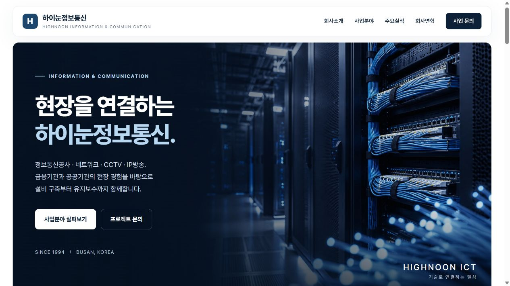

# 하이눈정보통신 기업소개 홈페이지

## 홈페이지 바로가기

**[하이눈정보통신 홈페이지 열기](https://kclock-boop.github.io/hinoonict/)**

KT 협력사 하이눈정보통신의 정보통신공사, 네트워크, CCTV, IP방송과 유지보수 사업을 소개합니다.
밝은 화이트·블루 디자인으로 회사소개 · 사업분야 · 주요실적 · 현장사진 · 회사연혁 · 문의 안내를 PC와 모바일에서 확인할 수 있습니다.

## 홈페이지 구성

- [회사소개 및 홈페이지 파일](./index.html)
- [메인 통신탑 이미지](./assets/telecom-tower-sunset.png)
- [네트워크 유지보수 이미지](./assets/network-maintenance.jpg)
- [사용자 제공 현장사진](./assets/field-safety-meeting.png)
- [내용 출처와 제작메모](./제작메모.txt)

## 자료 기준

회사 기본정보, 연락처, 연혁과 실적은 제공된 회사 지명원을 기준으로 작성했습니다.
메인 이미지는 사용자가 제공한 노을 배경의 통신탑 작업 이미지입니다. 현장사진은 사용자 제공 사진이며, 유지보수 이미지는 AI 생성 이미지입니다.
H 문자 표식은 공식 로고를 대신한 임시 표식입니다.
원본 PDF와 개인별 훈련 정보는 저장소에 포함하지 않습니다.

수정일: 2026-10-02
KT 기업소개: https://corp.kt.com/html/intro/main.html

메인 이미지 출처: 사용자 제공 통신탑 이미지

## 웹 · 휴대폰 앱 (PWA)

동일한 홈페이지를 브라우저 또는 홈 화면에 설치한 앱으로 이용할 수 있습니다.
- 안드로이드: Chrome 메뉴 → 앱 설치 / 홈 화면에 추가
- 아이폰·아이패드: Safari 공유 → 홈 화면에 추가 → 추가 (웹 앱으로 열기가 표시되면 켬)
- PC: Chrome·Edge 주소창 설치 아이콘 또는 브라우저 메뉴에서 앱 설치
- 첫 온라인 방문 시 회사소개와 주요 사진을 저장합니다. 이후 오프라인에서도 해당 콘텐츠를 볼 수 있습니다. 외부 사이트·문의 기능은 별도 연결이 필요합니다.

앱 파일: manifest.webmanifest, sw.js, app.js, app.css, assets/app-icon-192.png, assets/app-icon-512.png, assets/apple-touch-icon.png.
앱 설치는 HTTPS 또는 localhost에서 사용합니다. 앱스토어·플레이스토어 패키지가 아니라 홈 화면에 설치하는 웹 앱입니다.
수정 배포 시 sw.js의 CACHE_NAME 버전을 변경하세요. 앱에 새 버전 안내가 표시되면 사용자가 선택하여 갱신합니다. 모바일 실기기 설치 확인은 기기에서 진행해야 합니다.

설치 안내 기준: [MDN](https://developer.mozilla.org/en-US/docs/Web/Progressive_web_apps/Guides/Making_PWAs_installable), [Apple](https://support.apple.com/guide/iphone/iphea86e5236/ios).

## 비윤리 신고 안내

[비윤리 신고 페이지](./ethics.html)를 홈페이지 상단 메뉴와 하단 안내, 앱 바로가기에 연결했습니다.
신고·보상 안내 / 신고하기 / 처리결과 확인 탭을 PC·모바일에서 이용할 수 있습니다.
전용 신고 접수처와 보상 정책은 제공되지 않아 확정된 회사 제도로 게시하지 않았습니다. 대표메일로 신고 및 처리상황 문의 메일을 작성할 수 있으며, 메일 앱에서 직접 전송해야 합니다. 작성 양식 다운로드만으로 접수되지는 않습니다.
신고 수집, 익명 접수, 접수번호 발급 및 온라인 결과조회 서버는 연결하지 않았습니다. 처리결과는 접수 담당자에게 문의하도록 안내합니다.
운영 시 회사가 확정한 전용 접수처, 정보 취급·보호 기준, 보상제도 및 처리 절차를 반영하세요. 비윤리 신고 안내와 양식은 앱 오프라인 캐시에 포함됩니다.

비윤리 신고 추가 기능: 신고 작성 및 처리상황 문의 양식을 입력하면 대표메일 highnoon0377@naver.com으로 보낼 메일을 준비합니다. 사용자가 메일 앱에서 직접 전송해야 합니다. 본문 복사·텍스트 저장을 지원하며 입력 내용을 서버/브라우저 저장소에 저장하지 않습니다. 긴 내용은 제목만 메일로 넘기고 본문 복사를 안내합니다. 자동 접수와 온라인 결과조회는 제공하지 않습니다.

첫 접속 시 메인 이미지 위에 비윤리 신고·처리상황 문의 안내와 두 개의 바로가기 버튼을 표시합니다. PC·모바일에서 로그인이나 추가 메뉴 클릭 없이 안내를 확인할 수 있습니다.

## 현장 작업자 장애발생 보고서 (2026-10-24)

[장애발생 보고서](./incident.html): 현장·설비 정보, 장애 증상·영향, 원인·조치·후속 조치, 사진 최대 4장을 기록합니다. 복구완료 시 복구일시를 입력하며 발생~복구 시간을 계산합니다.
기기 임시저장 버튼으로 현재 브라우저의 IndexedDB에 보고서 1건과 사진을 보관합니다. 자동 저장·서버 접수·기기간 동기화는 없습니다. 불러오기와 기기 임시저장 삭제를 제공합니다.
미리보기 후 사진을 포함한 독립 HTML 보고서를 내려받거나 인쇄 창에서 PDF로 저장합니다. 파일은 회사가 지정한 방법으로 별도 전달해야 합니다. 원본 사진은 10MB 이하, JPG/PNG/WebP만 지원하며 보고서용 1600px 이하 JPEG로 줄여 첨부합니다. 사진의 원본 보존 용도로 사용하지 않습니다.
홈페이지 첫 화면, 상단·하단 메뉴, 앱 바로가기에 연결했으며 오프라인 앱 캐시에 포함합니다.

## 관련 링크

- [국가직무능력표준](https://www.ncs.go.kr/index.do)
